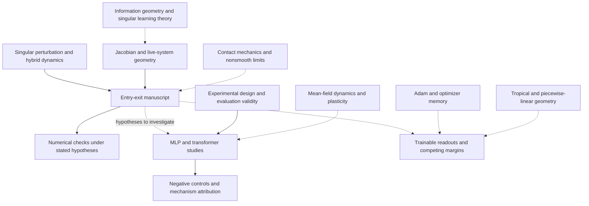

# Research map: training dynamics, geometry, and measurement

The entry-exit manuscript is the concrete result at the center of a broader
set of questions: how training changes the effective participation of a unit,
how local geometry shapes that change, and how experiments can distinguish
mechanisms from measurement artifacts. The original local working name was
J-Space. The public project is organized by research question and evidence.

This map connects material already present in the research record with relevant
fields. It does not claim a unified theory or completed research in every field.
Solid arrows below describe the released study's workflow. Dashed arrows denote
background, an analogy, or a proposed extension.

## Evidence levels

- **Manuscript result:** a theorem or proposition stated with its hypotheses in
  the current paper. This label does not imply external proof verification.
- **Numerical check:** a computation in specified instances, not a proof.
- **Empirical study:** an observation under an experimental protocol, with the
  experiment's own population, instrument, and controls.
- **Draft extension:** existing derivations or scripts whose proof obligations
  are not closed by the public release.
- **Background or proposed connection:** a useful question or analogy, not a
  result established by this repository.

## How the areas connect

| Area | Connection to this project | Evidence and boundary |
|---|---|---|
| **Singular perturbation and entry-exit theory** | A sharp activation creates an episode in which local dynamics and accumulated residual history must be analyzed together. | Central manuscript result. [De Maesschalck and Schecter](https://arxiv.org/abs/1511.01815) provide relevant entry-exit background; their theorem is not a substitute for checking this manuscript's hypotheses. |
| **Hybrid and nonsmooth dynamics** | The comparison trajectory switches between live evolution and a frozen inactive unit. | The manuscript compares a particular absorbing hard-ReLU continuation with the smooth-flow limit. It does not establish uniqueness of every nonsmooth continuation. |
| **Contact mechanics and constrained dynamics** | Contact, sticking, and release supplied the original organizing analogy. | [Historical conjecture guide](research-notes/2026-07-24-contact-penalty-target.md). A general equivalence to complementarity or sweeping processes has not been proved here. |
| **Jacobian geometry and kernel dynamics** | A unit's zero incoming-parameter block and the live subsystem's response help separate local inactivity from global network behavior. | The affine forcing extension is in the manuscript. A zero block need not reduce the full Jacobian rank. [NTK theory](https://arxiv.org/abs/1806.07572) is relevant background; this release does not derive an NTK-limit entry-exit theorem. |
| **Information geometry** | A possible question is how changing the parameter-space metric would change the inactive episode and release law. | Background and proposed comparison. The current theorem uses ordinary gradient flow; natural-gradient behavior has not been established here. See [Amari's natural-gradient work](https://doi.org/10.1162/089976698300017746). |
| **Singular learning theory** | Non-identifiability and statistical singularity raise questions distinct from the dynamics of an inactive unit. | Background. [Watanabe's singular-model analysis](https://jmlr.org/papers/v14/watanabe13a.html) concerns statistical asymptotics. No learning coefficient or generalization law is derived in this repository. |
| **Mean-field and Wasserstein dynamics** | A population description could connect single-unit episodes with changing distributions of units. | Proposed extension. [Mei, Misiakiewicz, and Montanari](https://proceedings.mlr.press/v99/mei19a.html) study distributional training dynamics. The small finite networks here do not establish that limit. |
| **Tropical and piecewise-linear geometry** | Competing margins suggest studying which datum dominates a unit's dynamics and when dominance changes. | [Multiple-margin scoping](research-notes/2026-07-27-multiple-margin-scoping.md) is exploratory. [Zhang, Naitzat, and Lim](https://proceedings.mlr.press/v80/zhang18i.html) study ReLU representations; that connection does not prove the draft's dynamical claims. |
| **Optimization and memory** | Trainable readouts and Adam introduce additional evolving variables and possible release clocks. | [Readout draft](../theory/trainable-readout-draft.tex) and [Adam pilot](../experiments/adam-memory/README.md). These are separate from the released gradient-flow theorem. |
| **Neural-network plasticity** | Inactive and returning units are one mechanism relevant to changing trainability. | The [MLP](../experiments/mlp/README.md) and [transformer](../experiments/transformer/README.md) studies are small and synthetic; their observations do not characterize all loss of plasticity. |
| **Evaluation methodology** | Controls, eligibility rules, censoring, clustering, and falsification determine what an observed return rate means. | Directly represented in the [negative results](../experiments/NEGATIVE-RESULTS.md) and frozen protocols. The connection to LLM evals is methodological; this repository is not an LLM benchmark. [Statistical evaluation practice](https://www.anthropic.com/research/statistical-approach-to-model-evals) provides related context. |

## Three useful reading routes

**For mathematical readers:** start with the manuscript's assumptions and
Theorems 2 and 6, then the [proof guide](../theory/README.md), the
[publication corrections](REVIEW.md), and the trainable-readout and
multiple-margin drafts. Keep the different initializations and theorem scopes
separate.

**For research engineers:** start with the [quick artifact check](REPRODUCIBILITY.md),
the two confirmatory study guides, and the data manifests. The main engineering
questions are whether the instrument observes the intended event and whether
the analysis uses the intended denominator.

**For evaluation researchers:** start with the invalidated 600-run instrument,
the redesign of the MLP area endpoint, and the transformer frozen/trainable
attention contrast. These cases show where a control or a measurement definition
changes the interpretation. They support discussion of evaluation design without
requiring claims about frontier-model performance.

## From connections to research tasks

The [roadmap](ROADMAP.md) turns selected connections into bounded questions with
explicit completion criteria. The [historical catalog](HISTORY.md) points to the
complete original notes. Additional research projects should be linked through
their own artifacts and evidence status, rather than treated as results of this
manuscript merely because they share a geometric vocabulary.
